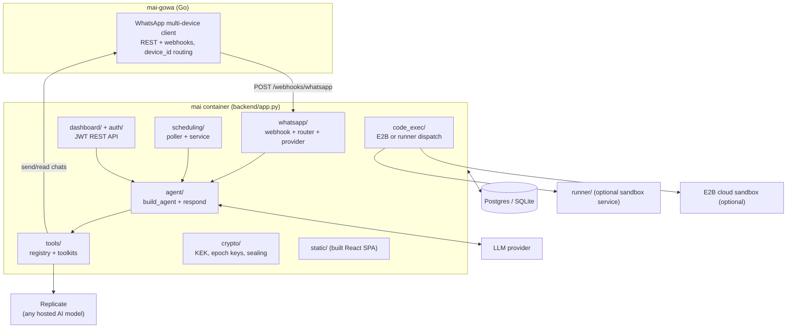
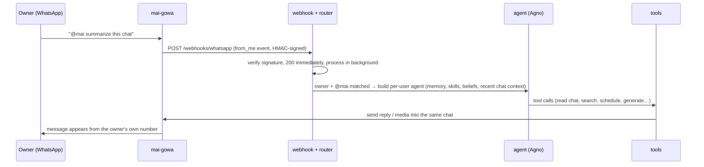
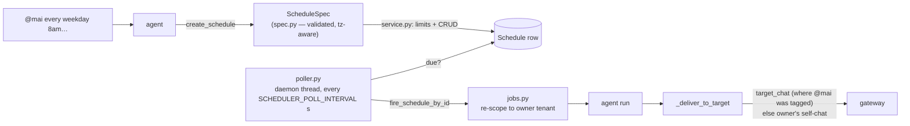
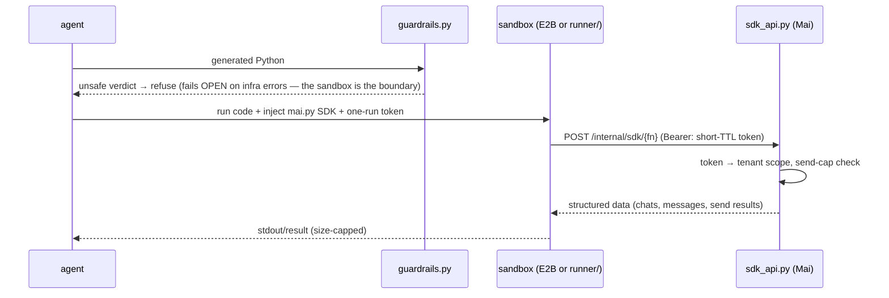

# Mai — architecture

One Python service (FastAPI + [Agno](https://github.com/agno-agi/agno) 2.x), one
database (Postgres; SQLite for local dev), one WhatsApp gateway
([mai-gowa](https://github.com/XiRoSe/mai-gowa)). The React dashboard is built at
Docker-build time and served by the same backend from `./static`, so SPA and API
share one origin and one port (`PORT`, default 7777).

## Component map

## Backend modules (`backend/`)

**`app.py`** — the composition root. `create_app()` initializes the DB, builds an
Agno `AgentOS` app (with Agno's own scheduler disabled), then mounts: auth,
dashboard + CRM, WhatsApp webhooks, billing (Polar) webhooks, admin, an internal
schedule-fire endpoint, the seal-pubkey endpoint, the code-exec SDK API, Google
OAuth, and finally the SPA (exact `/` route first, catch-all last so API routes
win). It also starts two daemons: the schedule poller and the encrypted-store
purge. `app` is exposed lazily via module `__getattr__`, so importing the module
never requires a model key.

**`config.py`** — a single pydantic-settings `Settings` class; every knob is an
env var (see [docs/configuration.md](docs/configuration.md)). Catches the one
config mistake that would otherwise degrade silently — semantic recall on
without an embedder key — by auto-disabling recall with a loud warning at boot.

**`db/`** — `base.py` (engine/session), `tenancy.py` (Account → User → owned
rows; every user-owned row carries both `account_id` and `user_id`),
`scoped.py` — **`TenantScope`, the fail-closed enforcement point**: there is no
API to get an unfiltered query over a tenant-owned model; a missing tenant filter
raises instead of leaking. `agno_db.py` bridges `MAI_DB_URL` to Agno's own
Postgres/SQLite db (sessions, memory) on the same database.

**`agent/`** — `mai_agent.py` builds a per-user Agno `Agent` (model + memory +
skills + tools) and exposes `respond()`, the single model-calling seam (tests
mock it). `prompts.py` builds the system prompt, including the untrusted-content
boundary for forwarded chat text. `beliefs.py` is a per-user "understanding" doc
refreshed by background reflection every N messages. `semantic.py` does embedding
recall (Together hosted embeddings + cosine): only relevant memories/skills are
injected each turn, falling back to inject-everything if the embedder is down.
`runtime_memory.py` is a RAM-only rolling buffer, never persisted.

**`tools/`** — one file per toolkit: WhatsApp actions (send/read other chats,
media, reactions), memory, schedules, skills, profile, credentials, access
grants, web search (DuckDuckGo), Replicate generation, code exec, docs/knowledge
base. `registry.py` assembles the per-turn toolset; `is_owner=False` (a guest
invoking @mai in a granted chat) is a security boundary — guests only get
stateless tools. `tool_router.py` is an optional LLM pre-router that picks tool
categories per message (off by default; it fails open to the full toolset).

**`whatsapp/`** — `provider.py` defines the provider interface;
`gowa.py` implements it against the mai-gowa fork (`device_id` per tenant,
HMAC-verified webhooks, sealed-payload decryption). `webhook.py` mounts
`GET/POST /webhooks/whatsapp`: signature is checked before anything else, then
processing happens in a background task so the gateway gets an instant 200.
`router.py` implements the core product rule: **react only to the owner's own
messages containing `@mai`**, everything else is ignored; guests can trigger it
only in chats the owner granted (`access.py`). `media_in.py` reads inbound
images/audio via Replicate; `encstore.py` is the encrypted, time-windowed message
store — Mai's only chat history; `connections.py` handles QR login / status;
`dedupe.py` stops Mai reacting to its own replies. A `meta.py` provider for the
official Cloud API exists but the product model targets `gowa`.

**`scheduling/`** — `spec.py` (validated, tz-aware `ScheduleSpec`), `models.py`,
`service.py` (CRUD + per-user limits), `jobs.py` (`fire_schedule_by_id`,
tenant-scoped and idempotent), `poller.py` — an in-process daemon thread that
wakes every `SCHEDULER_POLL_INTERVAL` seconds and fires due schedules into their
owner's WhatsApp.

**`dashboard/` + `auth/`** — JWT-protected REST API for the SPA (register/login
in `auth/`, everything else in `dashboard/api.py` + `crm.py`), tenant-scoped like
every other entry point.

**`crypto/`** — `keyservice.py` keeps a fresh random X25519 keypair per 2-day
epoch; each private key is wrapped (NaCl secretbox) under the KEK (`MAI_KEK`)
before storage, and old epochs are crypto-shredded (`purge.py`). `sealing.py`
implements NaCl sealed boxes wire-compatible with Go, so the gateway can seal
message bodies to Mai's current public key (`api.py` serves it at
`GET /internal/seal-pubkey`, token-gated).

**Skills** — `skills_loader.py` loads bundled `SKILL.md` packages from `skills/`
(drop a folder in, no code change); `skills_store.py` makes them per-user: seeded
into the DB on first use, editable from chat/dashboard, materialized back to a
temp dir for Agno's `LocalSkills`.

**`code_exec/` + `runner/`** — optional "code as action": the agent writes Python
that runs in a sandbox (E2B cloud, or the self-hosted stateless `runner/`
service) and calls back into Mai through a short-lived token-scoped SDK
(`sdk_api.py`, `dispatch.py`) with guardrails and send caps.

**Everything else** — `chat_history.py` (unified web + WhatsApp transcript for
the dashboard), `delivery.py` (single outbound seam), `provisioning.py` /
`onboarding.py` (account/user creation + first-run welcome), `billing/`
(Polar.sh entitlement — self-hosters just stay entitled by default settings),
`metering/` (usage counters + quotas), `credentials.py` (encrypted per-tenant
credential vault for skills), `admin.py` (token-gated ops endpoints),
`logging_config.py` (structured logs with trace ids; message bodies logged only
if explicitly enabled).

## Frontend (`frontend/`)

React 18 + TypeScript + Vite + Ant Design. Pages for chat, schedules, skills,
memory, WhatsApp connection (QR), and settings. `npm run dev` for development;
the multi-stage `Dockerfile` builds it with an empty `VITE_API_URL` so the SPA
calls the origin it is served from.

## Request flow: a `@mai` turn

Scheduled jobs enter the same pipe from the other side: the poller finds a due
`Schedule`, re-scopes to its owner, runs the agent, and delivers through that
tenant's gateway device.

## Subsystems in depth

The three subsystems people ask about most, end to end.

### Scheduling (`backend/scheduling/`)

Natural language in, a validated row out, an in-process poller firing it —
deliberately **not** an external job server, so a single container stays
sufficient.

The details that matter:

- **`spec.py` is the contract.** A `ScheduleSpec` is either one-off (`run_at`)
  or recurring (5-field `cron`), always paired with an IANA `timezone`. A bare
  time with no known timezone is a **validation error**, not a guess — the
  agent asks the user once and stores it. Invalid dates and malformed cron
  fail before anything persists.
- **`service.py`** owns CRUD plus per-user schedule limits (quota errors are
  surfaced to the agent as tool errors, so "you're at your limit" is a normal
  reply, not a crash).
- **`poller.py`** is a daemon thread started by `app.py`: every
  `SCHEDULER_POLL_INTERVAL` seconds (default 15, floor 5) it scans all tenants
  for due schedules — a one-off whose `run_at` has passed fires exactly once;
  a cron entry fires when `croniter` matches **in the schedule's own timezone**
  (the server clock stays UTC). Firing is idempotent and restart-safe: state
  lives in the row, not the thread.
- **`jobs.py` (`fire_schedule_by_id`)** re-enters the normal agent pipeline
  under the owner's tenant scope — a scheduled run gets the same memory,
  skills, and tools as a live `@mai` turn.
- **Delivery targets the origin.** `Schedule.target_chat` is captured from the
  chat where `@mai` created it; `_deliver_to_target` sends there (text or
  media), falling back to the owner's self-chat/DM. Edits (pause, retime,
  retarget) go through the dashboard or plain chat.

### Replicate: any model, no pinned models (`backend/tools/replicate_tools.py`)

Rather than wiring specific models ("image gen = X, transcription = Y"), Mai
gives the agent three *generic* tools and lets it choose per task:

1. `search_models(query)` — find candidate models for the task at hand
   (image generation/editing, transcription, TTS, video, upscaling…).
2. `get_model_schema(owner/name)` — fetch that model's exact input fields.
3. `run_model(owner/name, inputs)` — run **any public Replicate model** with a
   JSON of inputs (`inputs` accepts a dict *or* a JSON string — LLMs produce
   both; forcing one type was a production crash once).

The toolkit is registered per turn only when `REPLICATE_API_TOKEN` is set and
the tool router detects a generation-shaped intent — no token, no tools, no
prompt bloat. Outputs flow back as URLs, which `media_tools.py`
(`send_image` / `send_video`) posts into the chat as real WhatsApp media.

**Inbound media is on-demand, not automatic.** The router does not
auto-transcribe every voice note or describe every photo (cost + privacy).
Instead it injects a tagged marker into the agent's context —
`[Attached audio: <fetchable url> — fetch/transcribe/edit it on demand]` — and
the agent decides whether to run a vision/Whisper model when you actually ask
(`@mai what did she send?`). Defaults for those paths live in
`REPLICATE_VISION_MODEL` / `REPLICATE_TRANSCRIBE_MODEL` / `REPLICATE_VIDEO_MODEL`
(`backend/whatsapp/media_in.py`).

### Sandboxed code execution (`backend/code_exec/` + `runner/`)

Optional, off by default (`CODE_EXEC_ENABLED=false`). When on, the agent can
solve compute-shaped tasks by *writing Python* that runs outside Mai's process
and talks back through a narrow, authenticated SDK.

Layer by layer:

- **Guardrail (`guardrails.py`).** One fast LLM call screens the generated code
  before it runs. It fails **closed** on an explicit unsafe verdict and **open**
  on infrastructure errors — deliberate: the sandbox below is the real security
  boundary, the guardrail only cuts obvious nonsense early. The code is treated
  as data; instructions inside it are never followed.
- **Two interchangeable backends** behind `dispatch.py`: **E2B**
  (`E2B_API_KEY`) gives each run a disposable cloud VM; the self-hosted
  **`runner/`** service (`RUNNER_URL` + `RUNNER_SHARED_SECRET`) executes each
  run in a hardened, ephemeral subprocess — `RLIMIT_CPU` (timeout+1),
  `RLIMIT_AS` (memory), `RLIMIT_FSIZE` (10 MB), `RLIMIT_NPROC` (64), throwaway
  temp dir, zero state between runs (`runner/executor.py`). Neither backend
  can see Mai's process, database, or keys.
- **The `mai` SDK (`mai_sdk.py`)** is a single file uploaded into the sandbox
  and imported as `mai`. Every call it makes goes over HTTP to
  `POST /internal/sdk/{fn}` with a **one-run bearer token** minted by
  `token_store.py`: TTL `CODE_EXEC_TOKEN_TTL_SECONDS` (default 300 s), bound to
  one tenant, revoked when the run ends.
- **Server-side authority.** `dispatch.py` resolves every reference against the
  *token's* tenant — "me" is the token owner's number, never caller input — and
  enforces the per-run outbound **send cap** (`CODE_EXEC_SEND_CAP`), so a
  runaway or hostile script cannot spam or cross tenants. Results back into the
  agent are size-capped (`CODE_EXEC_MAX_RESULT_CHARS`).

## Invariants worth knowing before you patch anything

1. **Tenant isolation is fail-closed.** Go through `TenantScope`; never hand-roll
   a query on tenant-owned tables.
2. **Silent by default.** The router acts only on owner `from_me` messages with
   `@mai` (or granted guests). Don't add auto-reply paths.
3. **Guests never get stateful tools.** `is_owner=False` in the tool registry is
   a security boundary.
4. **One outbound seam** (`delivery.py`) and **one model seam** (`respond()`) —
   keep them single so tests and metering stay honest.
