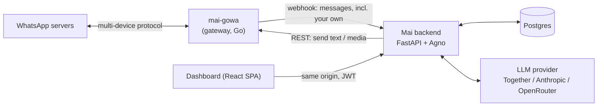

<h1 align="center">Mai</h1>
<p align="center"><strong>Your own AI assistant on WhatsApp — silent until you tag <code>@mai</code>.</strong></p>
<p align="center">
  <a href="docs/self-hosting.md">Self-host</a> ·
  <a href="docs/deploy-railway.md">Deploy on Railway</a> ·
  <a href="docs/configuration.md">Configuration</a> ·
  <a href="ARCHITECTURE.md">Architecture</a> ·
  <a href="https://github.com/XiRoSe/MAI_super_agent_for_whatsapp_opensource/discussions">Discussions</a> ·
  <a href="CHANGELOG.md">Changelog</a>
</p>
<p align="center">
  <a href="LICENSE"></a>
  <a href="https://github.com/XiRoSe/MAI_super_agent_for_whatsapp_opensource/actions/workflows/ci.yml"></a>
  <a href="https://github.com/XiRoSe/MAI_super_agent_for_whatsapp_opensource/releases"></a>
</p>

<!-- TODO: demo GIF -->

Mai links to **your own WhatsApp number** through an unofficial gateway. It stays
completely silent until *you* tag `@mai` in any conversation — then it reads the
recent context of that chat, does what you asked (answer, draft, search, schedule,
generate an image, message someone else), and replies **as you, in that chat**.

> Mai is an MVP maintained by one person. It works, it has tests, and it also has
> rough edges. Read the [Disclaimer](#disclaimer) before pointing it at a number
> you care about.

## Why Mai

Most WhatsApp bots are a *separate contact* you message, or a bot squatting in a
group. Mai is different: it rides along on your own number, in every chat you
already have, and only wakes up when you summon it.

- **Tag it anywhere.** `@mai summarize the last 20 messages`, `@mai reply to this
  politely in Spanish`, `@mai send Dana the address` — in any private or group chat.
- **Acts as you.** Replies come from your number, into the same conversation. Mai
  can also act across chats ("@mai forward this to the team group").
- **Delegated access.** Grant specific chats to other people, so *they* can invoke
  `@mai` there too — with a strictly limited toolset, never your private data.
- **Natural-language scheduling.** "@mai every weekday at 8am send me a morning
  brief" — a cron-backed poller fires it on time, in your timezone.
- **Skills and memory.** Per-user skills are plain-Markdown `SKILL.md` packages you
  can add and edit; agentic memory plus semantic recall keeps what matters and
  injects only the relevant pieces each turn.

## Features

- `@mai` trigger on your own number — silent otherwise, no auto-replies to your contacts
- Reads recent chat context, replies into the same chat, as you
- Cross-chat actions: send, forward, and look things up in your other chats
- Natural-language one-off and recurring schedules (cron poller, timezone-aware)
- Per-user skills as editable `SKILL.md` packages, with semantic recall
- Long-term agentic memory plus a per-user "understanding" that evolves in the background
- Delegated per-chat access for other people, with a restricted guest toolset
- Media in and out: reads images/audio you receive, generates images via Replicate
- Optional sandboxed Python execution (E2B cloud sandbox or a self-hosted `runner/`)
- Web dashboard (React + Ant Design) served by the same container — chat, schedules, skills, connection QR

## Quick start (Docker Compose)

Prerequisites: Docker with Compose v2, an LLM API key
([Together AI](https://www.together.ai/) works out of the box), and a WhatsApp
number to link (see the [Disclaimer](#disclaimer) — prefer a number you can
afford to lose).

```bash
git clone https://github.com/XiRoSe/MAI_super_agent_for_whatsapp_opensource.git mai
cd mai
cp .env.example .env
```

Edit `.env` and set at minimum:

```bash
TOGETHER_API_KEY=...        # LLM + embeddings (or configure another provider, see docs)
MAI_JWT_SECRET=...          # long random string (dashboard logins)
MAI_ENCRYPTION_KEY=...      # python -c "from cryptography.fernet import Fernet; print(Fernet.generate_key().decode())"
GOWA_PASSWORD=...           # password Mai uses to talk to the gateway
GOWA_WEBHOOK_SECRET=...     # HMAC secret for gateway -> Mai webhooks
```

Then:

```bash
docker compose up -d --build
```

Open http://localhost:7777, create your account, scan the QR code with WhatsApp
(**Settings → Linked devices**), and tag `@mai` in any chat. Full walkthrough:
[docs/self-hosting.md](docs/self-hosting.md).

## How it works



Two containers do the work: `mai` (this repo — API + agent + dashboard in one
image) and `gowa` (the WhatsApp gateway). Postgres holds everything. When you tag
`@mai`, the gateway forwards your own message to Mai's webhook; the router matches
the trigger, builds a per-user agent (model + memory + skills + tools), and sends
the reply back through the gateway into the same chat.

More detail: [ARCHITECTURE.md](ARCHITECTURE.md).

## The gateway

Mai talks to WhatsApp through [**mai-gowa**](https://github.com/XiRoSe/mai-gowa),
a fork of [aldinokemal/go-whatsapp-web-multidevice](https://github.com/aldinokemal/go-whatsapp-web-multidevice)
(GOWA, MIT). **Stock GOWA will not work** — Mai depends on things the fork adds:

- `device_id` routing, so one gateway instance can host multiple numbers
- webhook events for **your own outgoing messages** (`from_me`) — that's how the
  `@mai` trigger fires at all
- optional sealed webhook payloads (messages encrypted to Mai's rotating epoch key)

Why the fork exists and what the webhook contract looks like: [docs/gowa.md](docs/gowa.md).

## Deploy on Railway

The repo ships `railway.json`, a `Procfile`, and a single-image `Dockerfile`, so
Railway can build it straight from GitHub. You need: this repo as a service, a
Postgres plugin, a second service built from the
[mai-gowa](https://github.com/XiRoSe/mai-gowa) repo with a volume at
`/app/storages`, and the env vars wired between them.

Step-by-step: [docs/deploy-railway.md](docs/deploy-railway.md).

## Configuration

All settings are environment variables (optionally via `.env`), typed and defaulted
in [`backend/config.py`](backend/config.py). `.env.example` is the annotated
template; [docs/configuration.md](docs/configuration.md) is the full reference —
model providers, database, gateway, crypto, scheduling, quotas, code execution.

## Development

```bash
# backend (Python 3.11)
py -3.11 -m venv .venv          # or: python3.11 -m venv .venv
.venv/Scripts/activate           # Windows; macOS/Linux: source .venv/bin/activate
pip install -e ".[dev]"
pytest -q                        # offline: the model is mocked, no keys needed
ruff check .

# frontend
cd frontend
npm install
npm run dev                      # Vite dev server

# run the backend against SQLite (no Postgres needed)
uvicorn backend.app:app --port 7777
```

There is also a small REPL harness (`mai` after `pip install -e .`) that drives the
agent without WhatsApp. See [CONTRIBUTING.md](CONTRIBUTING.md).

## Roadmap

Honest and short — this is a solo project:

- Optional adapter for the official WhatsApp Business Cloud API (different
  trade-offs: no ban risk, but no @mai-on-your-own-number model)
- More model providers (the factory currently speaks Together, Anthropic, OpenRouter)
- First-class single-tenant mode (the codebase is multi-tenant; a "just me" flag
  would simplify self-hosting further)
- Better dashboard visibility into schedules, memory, and tool runs

Ideas and votes: [Discussions → Ideas](https://github.com/XiRoSe/MAI_super_agent_for_whatsapp_opensource/discussions).

## Hosted version

The maintainer runs a managed instance if you'd rather not self-host:
`<hosted URL — coming soon>`.

## Contributing

PRs welcome — small ones merge fastest; open an issue first for anything big.
Commits must be signed off (`git commit -s`, [DCO](https://developercertificate.org/) —
no CLA). See [CONTRIBUTING.md](CONTRIBUTING.md).

## License

[MIT](LICENSE) © 2026 XiRoSe. Third-party components are listed in
[THIRD_PARTY_NOTICES.md](THIRD_PARTY_NOTICES.md).

## Disclaimer

Mai is an independent project. It is **not affiliated with, associated with,
authorized, endorsed by, or in any way officially connected with WhatsApp,
WhatsApp LLC, or Meta Platforms, Inc.** "WhatsApp" is their trademark.

Mai connects to WhatsApp through an unofficial gateway (mai-gowa, based on
GOWA/whatsmeow) that emulates the WhatsApp Web multi-device protocol. Using
unofficial clients may violate WhatsApp's Terms of Service and **can get a phone
number warned, temporarily blocked, or permanently banned**. Use a number you can
afford to lose. Mai is built to be *your own personal assistant on your own
account* — do **not** use it for unsolicited, bulk, marketing, or broadcast
messaging, or for surveillance, scraping, or monitoring people without their
consent.

The LLM provider *you* configure (Together, Anthropic, OpenRouter, ...) receives
the message content Mai processes, under your API key and their terms. Mai itself
sends **no telemetry** to the maintainer. Software is provided "as is"
(see [LICENSE](LICENSE)). Full version: [DISCLAIMER.md](DISCLAIMER.md).
