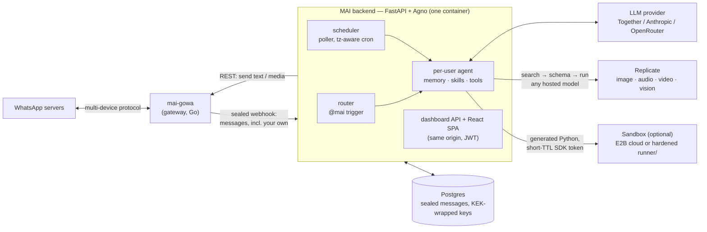

<h1 align="center">MAI — Modular AI</h1>
<p align="center"><strong>Your own AI assistant on WhatsApp — silent until you tag <code>@mai</code>.</strong></p>
<p align="center">
  <a href="docs/self-hosting.md">Self-host</a> ·
  <a href="docs/deploy-railway.md">Deploy on Railway</a> ·
  <a href="docs/configuration.md">Configuration</a> ·
  <a href="ARCHITECTURE.md">Architecture</a> ·
  <a href="https://github.com/XiRoSe/MAI_super_agent_for_whatsapp_opensource/discussions">Discussions</a> ·
  <a href="CHANGELOG.md">Changelog</a>
</p>
<p align="center">
  <a href="LICENSE"></a>
  <a href="https://github.com/XiRoSe/MAI_super_agent_for_whatsapp_opensource/actions/workflows/ci.yml"></a>
  <a href="https://github.com/XiRoSe/MAI_super_agent_for_whatsapp_opensource/releases"></a>
</p>

<!-- TODO: demo GIF -->

MAI links to **your own WhatsApp number** through an unofficial gateway. It stays
completely silent until *you* tag `@mai` in any conversation — then it reads the
recent context of that chat, does what you asked (answer, draft, search, schedule,
generate an image, message someone else), and replies **as you, in that chat**.

> MAI is an MVP maintained by one person. It works, it has tests, and it also has
> rough edges. Read the [Disclaimer](#disclaimer) before pointing it at a number
> you care about.

## Why MAI

Most WhatsApp bots are a *separate contact* you message, or a bot squatting in a
group. MAI is different: it rides along on your own number, in every chat you
already have, and only wakes up when you summon it.

- **Tag it anywhere.** `@mai summarize the last 20 messages`, `@mai reply to this
  politely in Spanish`, `@mai send Dana the address` — in any private or group chat.
- **Acts as you.** Replies come from your number, into the same conversation. MAI
  can also act across chats ("@mai forward this to the team group").
- **Delegated access.** Grant specific chats to other people, so *they* can invoke
  `@mai` there too — with a strictly limited toolset, never your private data.
- **Natural-language scheduling.** "@mai every weekday at 8am send me a morning
  brief" — a cron-backed poller fires it on time, in your timezone.
- **Skills and memory.** Per-user skills are plain-Markdown `SKILL.md` packages you
  can add and edit; agentic memory plus semantic recall keeps what matters and
  injects only the relevant pieces each turn.
- **Any AI model, one tag away.** Through Replicate, MAI can discover and run
  virtually any hosted model — image generation and editing, transcription,
  text-to-speech, video, upscaling — without you pinning a single model name.
- **Encrypted by design.** Message payloads are sealed by the gateway to a
  rotating key before they ever reach MAI's process; nothing readable sits in
  the database.

### What that looks like

```text
── family group ────────────────────────────────────────────────
Mom:   are we doing dinner friday or saturday??
Dad:   saturday works
Sis:   friday better for me
You:   @mai summarize where this landed and suggest a time
MAI:   Split vote: Dad wants Saturday, your sister Friday. Mom asked,
       no preference. Suggestion: Friday 19:30 — reply here to confirm?

── chat with a client ──────────────────────────────────────────
Client: can you send over the invoice by eod?
You:    @mai reply politely that it'll be there by 6pm, in Spanish
MAI:    (sends as you) Claro — la factura estará en tu correo hoy
        antes de las 18:00. ¡Gracias por la paciencia!

── your self-chat (notes to self) ──────────────────────────────
You:   @mai every weekday at 8am send me a brief of my unread groups
MAI:   Scheduled ✓ — weekdays 08:00 (Asia/Jerusalem), delivered here.

You:   @mai make a birthday image for Dana — golden retriever in a
       party hat, photorealistic
MAI:   (sends image) Generated with flux — want me to send it to Dana?

You:   @mai what did the football group decide while I was offline?
MAI:   They moved the game to Sunday 18:00 (same field). Tom can't
       make it; they're one short — want me to volunteer you?
```

## Features

- `@mai` trigger on your own number — silent otherwise, no auto-replies to your contacts
- Reads recent chat context, replies into the same chat, as you
- Cross-chat actions: send, forward, and look things up in your other chats
- Natural-language one-off and recurring schedules (cron poller, timezone-aware)
- Per-user skills as editable `SKILL.md` packages, with semantic recall
- Long-term agentic memory plus a per-user "understanding" that evolves in the background
- Delegated per-chat access for other people, with a restricted guest toolset
- Media in and out: describes images and transcribes voice notes you receive, generates images/video
- Run almost any AI model through Replicate: the agent searches, reads the schema, and runs it
- Optional sandboxed Python execution (E2B cloud sandbox or a self-hosted hardened `runner/`)
- Sealed-payload encryption: rotating epoch keys, KEK-wrapped at rest, no plaintext messages in the DB
- Web dashboard (React + Ant Design) served by the same container — chat, schedules, skills, connection QR

## Quick start (Docker Compose)

Prerequisites: Docker with Compose v2, an LLM API key
([Together AI](https://www.together.ai/) works out of the box), and a WhatsApp
number to link (see the [Disclaimer](#disclaimer) — prefer a number you can
afford to lose).

```bash
git clone https://github.com/XiRoSe/MAI_super_agent_for_whatsapp_opensource.git mai
cd mai
cp .env.example .env
```

Edit `.env` and set at minimum:

```bash
TOGETHER_API_KEY=...        # LLM + embeddings (or configure another provider, see docs)
MAI_JWT_SECRET=...          # long random string (dashboard logins)
MAI_ENCRYPTION_KEY=...      # python -c "from cryptography.fernet import Fernet; print(Fernet.generate_key().decode())"
GOWA_PASSWORD=...           # password MAI uses to talk to the gateway
GOWA_WEBHOOK_SECRET=...     # HMAC secret for gateway -> MAI webhooks
```

Then:

```bash
docker compose up -d --build
```

Open http://localhost:7777, create your account, scan the QR code with WhatsApp
(**Settings → Linked devices**), and tag `@mai` in any chat. Full walkthrough:
[docs/self-hosting.md](docs/self-hosting.md).

## How it works



Two containers do the work: `mai` (this repo — API + agent + scheduler +
dashboard in one image) and `gowa` (the WhatsApp gateway). Postgres holds
everything — sealed, not plaintext. When you tag `@mai`, the gateway forwards
your own message to MAI's webhook; the router matches the trigger, builds a
per-user agent (model + memory + skills + tools), and sends the reply back
through the gateway into the same chat. The scheduler enters the same pipeline
from the other side: a timezone-aware poller fires due jobs through the very
same agent. When a task needs a model beyond chat — image gen, transcription,
video — the agent picks one on Replicate at runtime; when it needs real
computation, it writes Python that runs in an isolated sandbox and talks back
through a capped, token-scoped SDK.

More detail: [ARCHITECTURE.md](ARCHITECTURE.md).

## Scheduled tasks

MAI turns natural language into validated schedules — no cron syntax needed
(though `create_schedule` stores a real 5-field cron under the hood):

```text
@mai remind me tomorrow at 9 to renew the passport
@mai every friday at 16:00 ask the football group who's in for sunday
@mai on the 1st of each month send me a summary of my subscriptions chat
```

How it works, concretely:

- The agent converts your request into a **typed `ScheduleSpec`** (one-off
  `run_at` or recurring `cron`), validated before anything is stored — an
  impossible date or a missing field fails loudly instead of silently.
- **Timezone-aware end to end.** Schedules run in *your* IANA timezone, not the
  server's (servers are UTC). A bare "8am" is rejected until MAI knows your tz —
  it will ask once and remember.
- An in-process **poller checks every 15 seconds** and fires due jobs — one-off
  times in the past fire immediately once; cron entries are matched in the
  schedule's own timezone. Restart-safe and idempotent.
- **Fires where you asked.** A schedule created by tagging `@mai` in a group
  delivers into that group; otherwise it lands in your self-chat/DM.
- Manage everything (list, edit, pause, delete) from the **dashboard** or by
  just asking: `@mai what's on my schedule?`.

## Almost any AI model, via Replicate

Set one env var (`REPLICATE_API_TOKEN`) and MAI's agent gets three generic tools
instead of a hardcoded model list:

| Tool | What the agent does with it |
|---|---|
| `search_models` | Discover a model for the task at hand — image gen/edit, transcription, TTS, video, upscaling, background removal… |
| `get_model_schema` | Fetch that model's exact input fields, so calls are well-formed |
| `run_model` | Run **any public Replicate model** (`owner/name`) with a JSON of inputs |

No models are pinned: when you say *"@mai turn this photo into a Pixar-style
render"*, the agent searches, reads the schema, runs the best match, and sends
the result back into the chat as real WhatsApp media (`send_image` /
`send_video`). The same mechanism powers **incoming** media: photos you receive
are described by a vision model and voice notes transcribed by Whisper, so
`@mai what did she send?` just works. Defaults are configurable
(`REPLICATE_VISION_MODEL`, `REPLICATE_TRANSCRIBE_MODEL`, `REPLICATE_VIDEO_MODEL`).

## Sandboxed code execution

Optional (off by default: `CODE_EXEC_ENABLED=false`). When enabled, MAI can
*write and run Python* for tasks that need real computation — crunching a CSV
someone sent, scraping a page, doing date math across chats — using a small
`mai` SDK injected into the sandbox.

Two isolation backends, your choice:

- **E2B cloud sandbox** (`E2B_API_KEY`) — each run gets a disposable cloud VM.
- **Self-hosted `runner/` service** (`RUNNER_URL` + `RUNNER_SHARED_SECRET`) — a
  tiny FastAPI service that executes each run in a **hardened, ephemeral
  subprocess**: CPU, memory (`RLIMIT_AS`), file-size and process-count rlimits,
  a hard timeout, a throwaway temp dir, and zero state between runs.

Defense in depth around either backend: an **LLM guardrail pre-screens the
generated code** before execution, sandbox→MAI callbacks use **short-TTL scoped
tokens**, and outbound messages from sandboxed code are **capped per run**
(`CODE_EXEC_SEND_CAP`) so a runaway script can't spam anyone.

## Encryption & privacy

MAI is built on the assumption that your WhatsApp messages are radioactive —
so it never stores them readable:

- **Sealed at the gateway.** The mai-gowa fork encrypts message bodies (and
  stored chat names) as **NaCl sealed boxes** — `NSEAL:<epoch>:<ciphertext>` —
  to MAI's current epoch public key *before* they cross the wire. Payloads
  arrive at MAI's webhook already encrypted.
- **Rotating epoch keys.** The sealing key rotates every ~2 days. The gateway
  fetches only the *public* key from a token-gated internal endpoint; epoch
  **private keys are persisted exclusively as KEK-wrapped ciphertext**
  (`MAI_KEK`) — a database dump alone cannot decrypt anything.
- **No plaintext at rest.** Message plaintext never leaves the crypto layer to
  disk; old sealed data is purged on a retention schedule
  (`MAI_SEAL_RETENTION_DAYS`).
- **Encrypted credential vault.** Per-user service credentials and OAuth tokens
  are Fernet-encrypted (`MAI_ENCRYPTION_KEY`) before storage.
- **Fail-closed.** In production, missing `MAI_KEK` / `MAI_JWT_SECRET` /
  `MAI_ENCRYPTION_KEY` refuse to run rather than degrade quietly; tenant
  isolation errors out instead of leaking across accounts.
- **Your LLM, your call.** Message content is sent to the model provider *you*
  configure — and nowhere else. Self-hosted MAI has no telemetry.

Details: [ARCHITECTURE.md](ARCHITECTURE.md) and [docs/gowa.md](docs/gowa.md).

## The gateway

MAI talks to WhatsApp through [**mai-gowa**](https://github.com/XiRoSe/mai-gowa),
a fork of [aldinokemal/go-whatsapp-web-multidevice](https://github.com/aldinokemal/go-whatsapp-web-multidevice)
(GOWA, MIT). **Stock GOWA will not work** — MAI depends on things the fork adds:

- `device_id` routing, so one gateway instance can host multiple numbers
- webhook events for **your own outgoing messages** (`from_me`) — that's how the
  `@mai` trigger fires at all
- optional sealed webhook payloads (messages encrypted to MAI's rotating epoch key)

Why the fork exists and what the webhook contract looks like: [docs/gowa.md](docs/gowa.md).

## Deploy on Railway

The repo ships `railway.json`, a `Procfile`, and a single-image `Dockerfile`, so
Railway can build it straight from GitHub. You need: this repo as a service, a
Postgres plugin, a second service built from the
[mai-gowa](https://github.com/XiRoSe/mai-gowa) repo with a volume at
`/app/storages`, and the env vars wired between them.

Step-by-step: [docs/deploy-railway.md](docs/deploy-railway.md).

## Configuration

All settings are environment variables (optionally via `.env`), typed and defaulted
in [`backend/config.py`](backend/config.py). `.env.example` is the annotated
template; [docs/configuration.md](docs/configuration.md) is the full reference —
model providers, database, gateway, crypto, scheduling, quotas, code execution.

## Development

```bash
# backend (Python 3.11)
py -3.11 -m venv .venv          # or: python3.11 -m venv .venv
.venv/Scripts/activate           # Windows; macOS/Linux: source .venv/bin/activate
pip install -e ".[dev]"
pytest -q                        # offline: the model is mocked, no keys needed
ruff check .

# frontend
cd frontend
npm install
npm run dev                      # Vite dev server

# run the backend against SQLite (no Postgres needed)
uvicorn backend.app:app --port 7777
```

There is also a small REPL harness (`mai` after `pip install -e .`) that drives the
agent without WhatsApp. See [CONTRIBUTING.md](CONTRIBUTING.md).

## Roadmap

Honest and short — this is a solo project:

- Optional adapter for the official WhatsApp Business Cloud API (different
  trade-offs: no ban risk, but no @mai-on-your-own-number model)
- More model providers (the factory currently speaks Together, Anthropic, OpenRouter)
- First-class single-tenant mode (the codebase is multi-tenant; a "just me" flag
  would simplify self-hosting further)
- Better dashboard visibility into schedules, memory, and tool runs

Ideas and votes: [Discussions → Ideas](https://github.com/XiRoSe/MAI_super_agent_for_whatsapp_opensource/discussions).

## Hosted version

The maintainer runs a managed instance if you'd rather not self-host:
`<hosted URL — coming soon>`.

## Contributing

PRs welcome — small ones merge fastest; open an issue first for anything big.
Commits must be signed off (`git commit -s`, [DCO](https://developercertificate.org/) —
no CLA). See [CONTRIBUTING.md](CONTRIBUTING.md).

## License

[MIT](LICENSE) © 2026 XiRoSe. Third-party components are listed in
[THIRD_PARTY_NOTICES.md](THIRD_PARTY_NOTICES.md).

## Disclaimer

MAI is an independent project. It is **not affiliated with, associated with,
authorized, endorsed by, or in any way officially connected with WhatsApp,
WhatsApp LLC, or Meta Platforms, Inc.** "WhatsApp" is their trademark.

MAI connects to WhatsApp through an unofficial gateway (mai-gowa, based on
GOWA/whatsmeow) that emulates the WhatsApp Web multi-device protocol. Using
unofficial clients may violate WhatsApp's Terms of Service and **can get a phone
number warned, temporarily blocked, or permanently banned**. Use a number you can
afford to lose. MAI is built to be *your own personal assistant on your own
account* — do **not** use it for unsolicited, bulk, marketing, or broadcast
messaging, or for surveillance, scraping, or monitoring people without their
consent.

The LLM provider *you* configure (Together, Anthropic, OpenRouter, ...) receives
the message content MAI processes, under your API key and their terms. MAI itself
sends **no telemetry** to the maintainer. Software is provided "as is"
(see [LICENSE](LICENSE)). Full version: [DISCLAIMER.md](DISCLAIMER.md).
